# Spectra Highlight、Reference 导入与 Die Map 选择验证

基线为 `v5.3.1` / `65a308b`，实现分支 `codex/spectra-highlight-contrast`。本文保留功能验收记录；后续修复、最终完整回归与 v5.3.2 安装包验证见 [Release 验证记录](v5.3.2-release-2026-11-17.md)。

真实样本为 `D:\spectra\SME\JC1913\EP01_20260822_AI04283.05`，读取 198 个 SME，无解析问题。沿用现有 BSL 通道匹配规则，99 条曲线参与 Residual；Wafer 模式每图 1 组，SME 模式每图 99 组，覆盖超过 32 组的 batch 路径。原文件 SHA-256 与所有原始数值数组的 SHA-256 前后相同。

## 行为与实现

- 普通选中保持原 Channel Color / 5 px，不改 Wafer / SME / Folder / TestFlag 分组含义。
- 手动、可持久化的 Highlight 使用白色 7.5 px Halo 与亮橙红 `#FF3D00` 3.2 px Core；均为不透明实线。亮色按用户后续要求替代初始深蓝方案；暗背景 Halo 改用浅色 `#E6EDF3`。
- 每个坐标轴一个 Overlay，先绘制所有 Halo，再绘制所有 Core，整体 z=30，位于普通曲线和原有选择线之上。Halo/Core 共享一次合并的选中几何，原始 `CurveSegment.x/y` 保持引用与 NaN 分段。
- 跨 Primary/Secondary 的实际场景叠放额外验证：仅提高曲线局部 z 无法跨越父 ViewBox。Secondary Highlight 因此使用一个随原轴范围/尺寸/反转同步的前景 ViewBox，确保两轴选中线都在两轴普通线之上。取消 Highlight 后前景 ViewBox 从场景移除并释放，不改变源轴范围；严格缓存/原生导出与释放测试通过。
- 普通曲线以 128/255 的有效透明度弱化。为避免多曲线叠加时缓存/原生颜色不一致，首次弱化会在 worker 生成新 raster；保留最多两个透明度版本，以复用不透明图像。成员变更不重算普通曲线的光谱数组。
- Overlay 缓存优先于背景弱化任务；4096 点以内的 Overlay 可在缓存完成前显示原生预览，大规模数据继续异步绘制。没有为每条光谱创建两套独立场景对象。
- Legend 图标同步 Halo/Core 与加粗；清除当前选择不清除持久 Highlight。新增独立 Clear Highlight，一次清除全部标记，可撤销/重做，无需保留当前选择。
- Die Map 只把 Highlight 点的填充改为亮橙红，保留原来的 12 px 大小、0.8 px 边框与坐标。选择圈、TestFlag、勾选状态继续独立工作。
- Die Map 未锁定时不再因 Viewer 激活自动 raise；锁定后才在应用内保持上方。取消锁定会移除该事件监听并停止待执行的 raise；其他浮窗原有策略保留。相关 31 个测试连续三次通过。
- 3 Sigma 通过现有 membership 命中聚合曲线，使用聚合段本身；不替换成原始 SME，不修改任何统计量或 Residual 数值。
- Reference/Raw 的 Trend 区间按当前 Wafer/Lot/PAD 身份匹配，独立于厂商列名；输入的数值、行映射与源限定参数 key 保持不变。修正身份时按原选中行保留勾选，撤销/重做重新计算。
- Ref 底部尺寸始终有可见空间，按实际文档范围刷新；新增粘贴/撤销测试。
- Spectra Group settings 增加 Set Test Flag 按钮，复用现有旗标编辑器。Group Script 保留正数、负数和多位旗标；Apply Script 为黑底白字。

## 2026-11-17 续修：CDSEM、KLA 与选择共享

CDSEM 坐标原本保留在 XLSX 的 CD Pivot 中，但单行 CSV 和 CD Results 只输出 COMMON + MP Result，未输出每个 MP 的 Wafer_X/Y；固定 LOCAL 列表还漏掉了源文件的 EdgeCenterPosX、CenterPosX(nm) 等字段。现在 CSV 与 CD Results 保持原有 MP Result 列名，并在后面增加 `MP / 字段名` 形式的每 MP 原始信息；CD Pivot 也保留额外源列。不同 MP 的绝对坐标不会互相覆盖。Wafer_ID 缺失继续为空，不推断身份，也不推断未标注的坐标单位。

实测 `D:\spectra\CDSEM\cd_sem_ref.xlsx`：源文件 17199 行，CD 行 1911，91 个 chip / 21 个 MP。逐一核对了 CSV 中 97461 个原始文本单元格；Excel 中也核对了绝对坐标与额外坐标字段。源文件 SHA-256 不变，空 Wafer_ID 保留。

生成的带完整坐标结果：[CDSEM1_cd_sem_ref_aa32e591.xlsx](D:/WaferMap/.cache/spectra-highlight-20261116/reference-real-output/Reference_Summary_Output/CDSEM1_20261117_004926_130917/CDSEM1_cd_sem_ref_aa32e591.xlsx)；[CSV](D:/WaferMap/.cache/spectra-highlight-20261116/reference-real-output/Reference_Summary_Output/CDSEM1_20261117_004926_130917/CDSEM1_cd_sem_ref_aa32e591_Results.csv)。原来用户输出文件未覆盖。

KLA 现在区分长设置段中的无实际 Site 数据的伪表头与真实数据表：设置中的重复/空 `Site #` 标题不会提前成为被拒绝的数据 block；真正带测量行的重复表头仍报 HEADER。每个 Channel 前 220 行设置的双 Channel 回归通过，数值文本和 Channel 身份不变。`D:\spectra\KLA` 的四个实际 CSV 共 208 行，前后逐条与 v5.3.1 相同、无 issue。**用户报告的那份报错文件仍未取得路径；已请求原件，不能声称覆盖了所有未知离线格式。**

Die Map 顶部增加独立的选择撤销、重做箭头按钮，支持 Ctrl+Z / Ctrl+Shift+Z，无下拉框。选择历史与 TestFlag、Highlight、勾选参与状态的文档编辑历史分开；更换数据后清空旧选择历史，分页不清空。按钮始终只处理选点；快捷键在已有选点历史时只处理选点，尚无选点历史时保留原有报告/TestFlag 编辑撤销。选点撤销到起点后不会意外撤销 Flag，Info 与 Map 原有共享编辑动作也保留并通过回归。

Copy Select / Paste Select 使用独立的 `metrology-die-selection` JSON，通过 Wafer/Lot/PAD/Die 精确匹配，不用文件路径或行号。一个 die 对应多个 SME 时同时选中这些 SME；未匹配 die 数显示在状态栏，完全无匹配或格式错误不修改现有选择；空选择可以复制后用于清除。粘贴选择也能撤销。

WKB 的 Out-of-range Die Map 增加 Select Out of Range，选择当前 Bias 超过配置 limit 且参与分析、具有有效坐标的点；保留严格 `abs(Bias) > limit` 的既有算法，再通过 Copy Select 传入 Spectra Viewer。此操作不改变 Flag、Highlight、数值或数据参与状态。

实际 Qt 控件截图（这一组使用小型明确标记的 UI 测试夹具）：

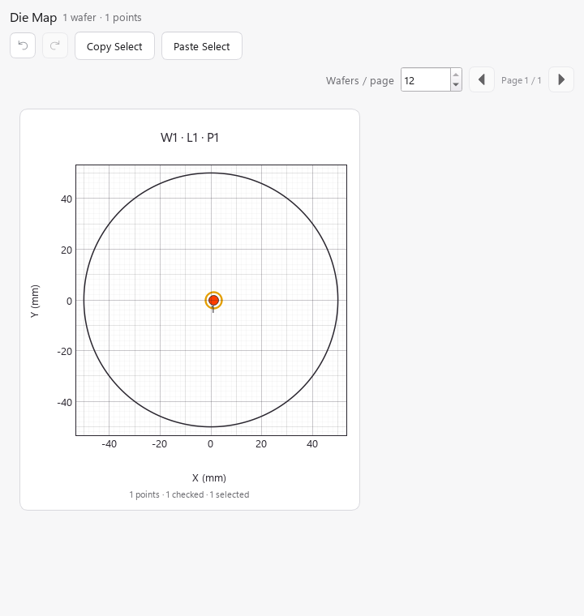

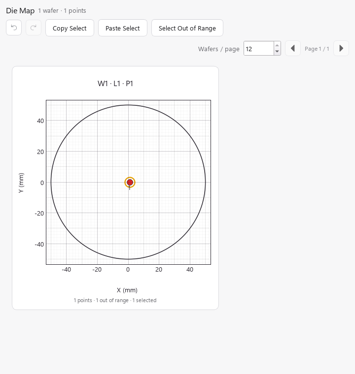

Clear Highlight 菜单：

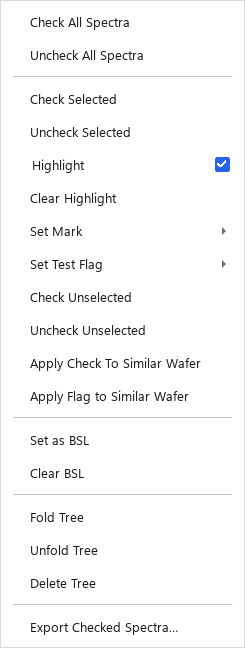

Group settings 中的 Set Test Flag 按钮：

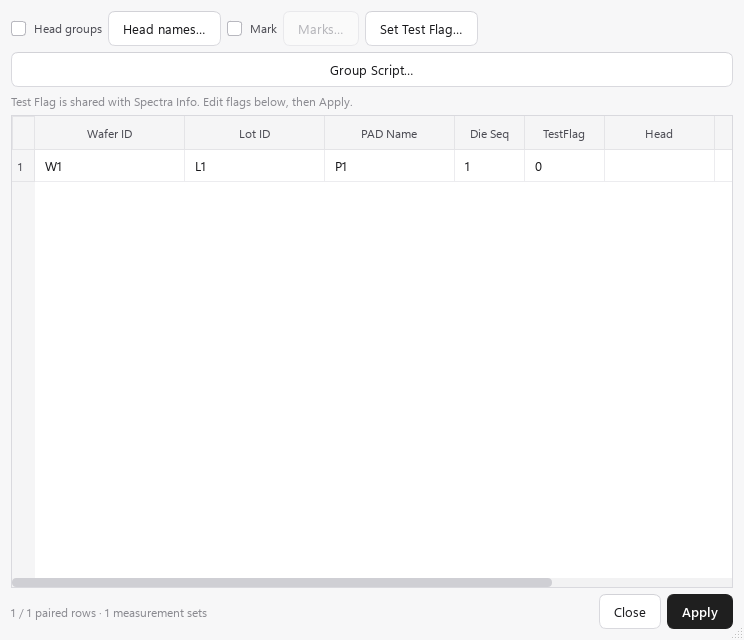

黑色 Apply Script：

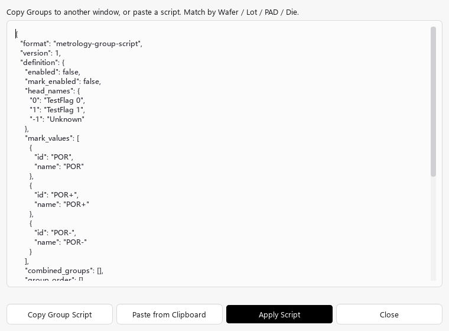

## 截图：真实 4×4 Mueller Residual

以下均使用真实 X/Y 与真实 Residual 数值；为复现用户所述的大量粉色重叠，**仅验收脚本**统一普通曲线为粉色。应用的 Wafer/SME 颜色身份规则未改。单选为 1 个文件、多选为 3 个文件；检查了全部 16 图，重点包括 M12、M14、M23、M32、M33、M41。轴范围、普通曲线缓冲引用、Die Map 点几何均不变。

修改前：


修改后单选：

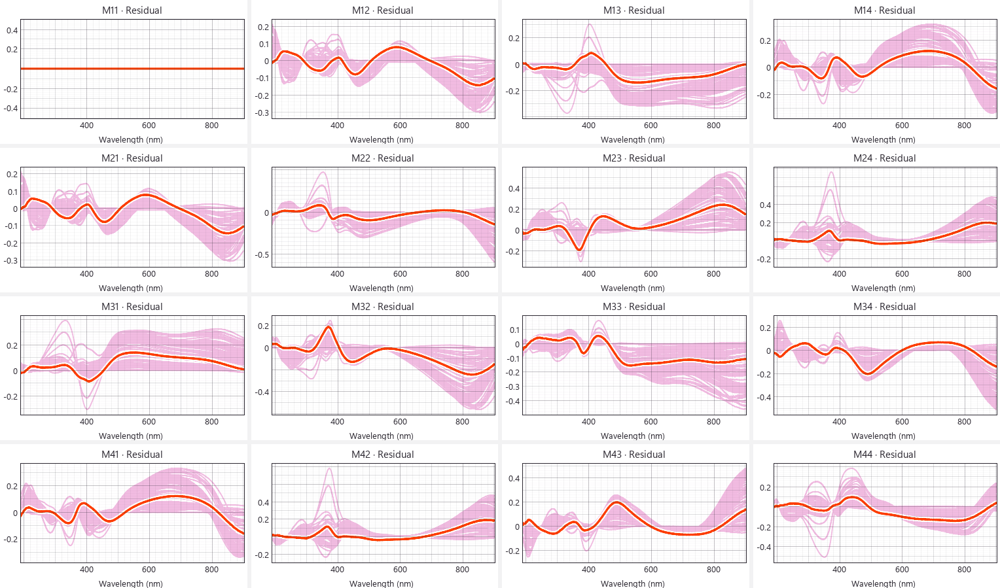

修改后多选：

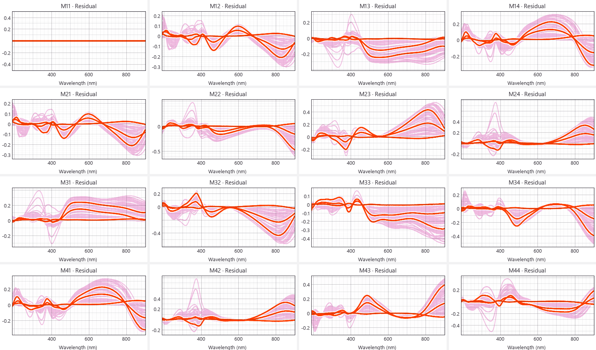

SME 模式，每图 99 组，走 batch 绘图：

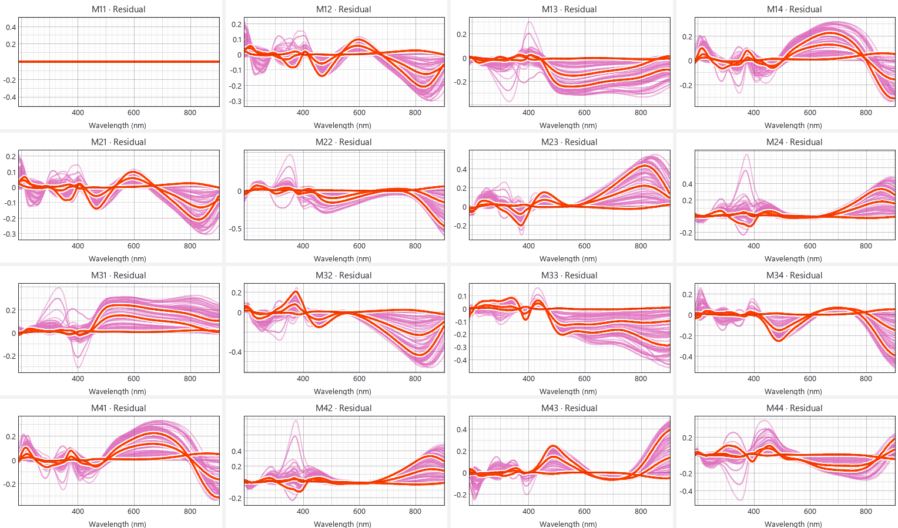

Die Map 只换填充色：

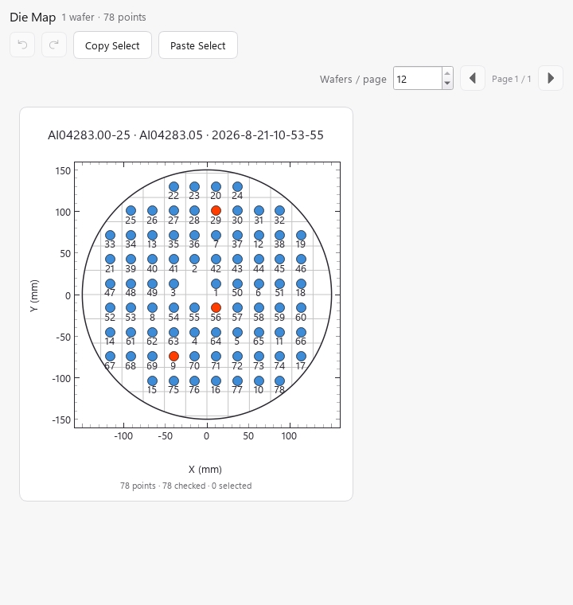

清除全部 Highlight：

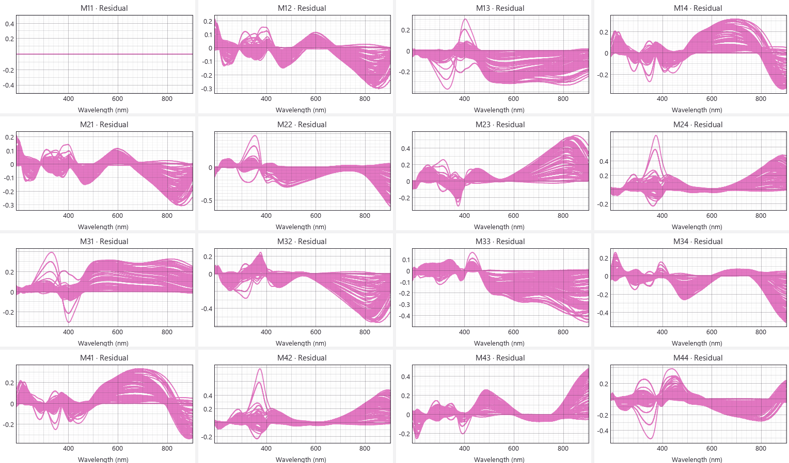

真实数据的 M12 屏幕/原生导出 8-bit 通道误差：Wafer mean=0.000000、max=0；SME batch mean=0.010375、max=2。脚本保留两种截图供核对。

## 截图：合成 4×4 Mueller 压力图

16 张图，每图 64 个分组、每条 5001 点，含 NaN 间隔。检查包含 M12、M14、M23、M32、M33、M41。

修改前单文件 Highlight：

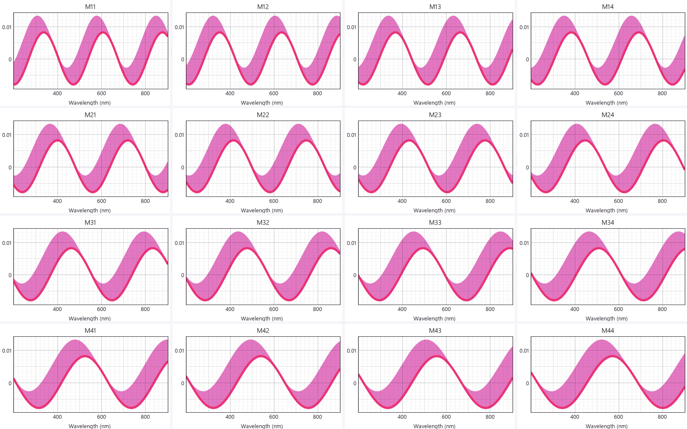

修改后单文件 Highlight：

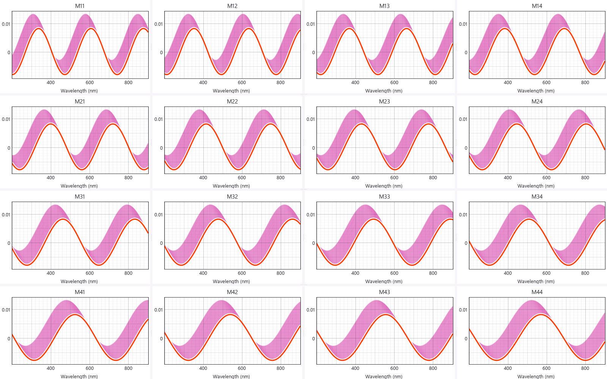

修改后三文件 Highlight：

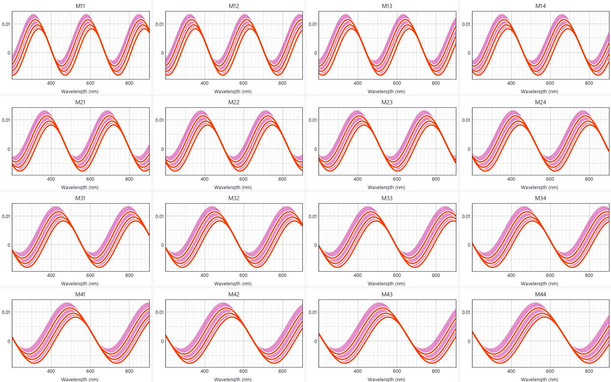

取消 Highlight：

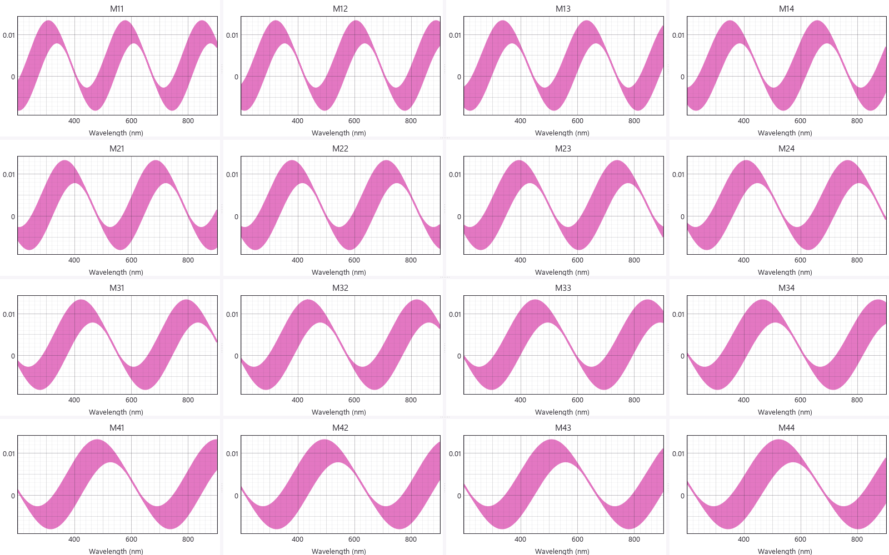

## 可重复测量

同一脚本、同一合成数组、同一字体和窗口大小；不代表所有机器的延迟保证。完整原始数据及 profile 位于相邻 JSON。

手动 Highlight，表格数值为“提交 / 全部缓存完成”，单位 ms：

| 操作 | v5.3.1 | 当前实现 |
| --- | ---: | ---: |
| single | 15.7 / 247.4 | 16.3 / 838.2 |
| multi | 26.0 / 345.7 | 16.9 / 795.7 |
| clear | 11.3 / 127.6 | 13.8 / 109.5 |
| single-repeat | 18.1 / 225.4 | 26.1 / 297.6 |

普通选中操作（ms），不改变其原有颜色样式：

| 文件数 | v5.3.1 | 当前实现 |
| --- | ---: | ---: |
| 1 | 11.7 | 12.4 |
| 3 | 21.8 | 22.6 |
| 0 | 7.2 | 6.6 |

首次透明度 raster 有额外成本，因此不宣称完整渲染时间变快。缓存热身后复用有效图像。普通源数组保持引用，源几何 revision 不变；60 次 Highlight 切换后场景数量为 33 → 33，另有弱引用测试证明 Overlay/cache 真正释放。

40 分组的严格缓存/原生像素测试保留 max≤4、mean<0.05 的既有标准，并通过。64×5001 点压力图的既有 0.25 px 屏幕几何简化继续保留：单图 8-bit 通道误差 mean=0.098192、max=28；基线 mean=0.035387、max=51。这不是逐位相同的声明。原生导出仍绘制完整可见源采样，原始数组与 NaN 不变。

合成、真实 SME 和 Save 基准均已在无并发测试时顺序重跑基线与当前版本，并记录实际加载的源码模块路径；全量回归随后启动。性能数字只描述本次机器与固定夹具。

真实 99 条 Residual 曲线的单选、三选与清除，数值为“提交 / 全部缓存完成”，单位 ms：

| 模式 / 操作 | v5.3.1 | 当前实现 |
| --- | ---: | ---: |
| wafer / single | 14.7 / 300.2 | 16.2 / 2067.2 |
| wafer / multi | 130.1 / 457.1 | 21.3 / 741.2 |
| wafer / clear | 3.0 / 91.3 | 6.5 / 91.8 |
| sme / single | 37.0 / 348.2 | 31.9 / 1622.4 |
| sme / multi | 63.1 / 535.0 | 50.4 / 769.4 |
| sme / clear | 20.1 / 123.3 | 24.3 / 153.6 |

Save 使用 SQLite 容器，普通表经 pandas `to_sql`，最终为 sqlite3 `executemany`；延迟光谱帧走已有原生批量复制。没有改变保存格式、备份、冲突保护、校验或 fsync。改动仅将大内存普通表纳入已有后台 I/O 路由，并避免 Recent 列表未变化时重复写设置。

Save 夹具：Ref 和 Raw 各 6000×33 个文字单元格，所有字符串逐一回读相等。

| 操作 | 原总耗时 ms | 当前总耗时 ms | 最大 GUI 心跳间隔 ms | 期间心跳数 |
| --- | ---: | ---: | ---: | ---: |
| first-save | 675.4 | 810.7 | 675.4 → 250.1 | 0 → 33 |
| overwrite | 1041.3 | 770.2 | 1041.3 → 63.1 | 0 → 65 |

覆盖保存期间的 GUI 停顿缩短，但首次保存总耗时未改善；首次 Recent 设置的持久化仍有可见成本。本轮不通过关闭保护或降低耐久性缩短数字，仍需用户真实 WKB 做进一步定位。

## 测试与实际输出

focused:

```text
Ran 254 tests in 149.520s

OK (skipped=2)
```

style_and_pin:

```text
Ran 31 tests in 12.038s

OK
```

final_related:

```text
Ran 154 tests in 76.515s

OK (skipped=1)
```

reference_io:

```text
Ran 26 tests in 8.231s

OK
```

map_selection:

```text
Ran 34 tests in 13.137s

OK
```

final_selection_icons:

```text
Ran 4 tests in 2.318s

OK
```

final_secondary_layers:

```text
Ran 16 tests in 6.861s

OK
```

map_info_undo:

```text
Ran 20 tests in 11.194s

OK
```

storage:

```text
Ran 25 tests in 10.807s

OK
```

reference_save_final:

```text
Ran 13 tests in 4.519s

OK
```

full:

```text
Ran 1567 tests in 1307.058s

FAILED (failures=5, errors=3, skipped=19)
```

focused 为首轮 254 个相关回归；最新完整相关回归 final_related 为 154 个（含指定 test_spectra_viewer / test_spectra_map 和 Info 编辑），另外 reference_io 为 26 个导入与坐标测试，map_selection 为 34 个选择/Flag/Bias 回归。最终跨轴/释放/导出样式回归为 16 个；选择快捷键与 Info/Flag 兼容性另外通过 20 个回归。Clear Highlight 的旧菜单预期已补齐并通过，选择箭头的字体缺字已改为 Qt 绘制图标并复查截图。31 个样式/锁定回归曾连续三轮通过。各完整日志路径与 SHA-256 记录在 JSON；全量实际输出另存为相邻 `spectra-highlight-2026-11-16-test-output.txt`。

全量失败/错误条目：

- ERROR: test_context_export_copies_only_checked_sme_in_original_folders (test_spectra_workbook.SpectraWorkbookTests)
- ERROR: test_path_save_type_removes_embedded_samples_and_reloads_original_files (test_spectra_workbook.SpectraWorkbookTests)
- ERROR: test_workbook_path_mode_and_missing_references_survive_save_without_embedding (test_spectra_workbook.SpectraWorkbookTests)
- FAIL: test_closing_changed_analysis_state_is_responsive_and_keeps_source (test_analysis_close_performance.AnalysisCloseTests)
- FAIL: test_raw_select_all_clear_and_undo_keeps_exact_cells_promptly (test_performance_regressions.WorkbookPerformanceTests)
- FAIL: test_saved_wide_workbook_dirty_checks_preserve_the_accepted_state_promptly (test_performance_regressions.WorkbookPerformanceTests)
- FAIL: test_wafer_window_opens_with_current_cards_and_uses_new_coefficients_after_edit (test_performance_regressions.WorkbookPerformanceTests)
- FAIL: test_plain_cells_avoid_generic_recursive_serialization_cost (test_writer_cell_serialization.WriterCellSerializationTests)

全量未全绿。三个 SME Workbook 错误来自旧测试写死的另一台机器路径 `C:\Users\Yuanhao Qin\OneDrive\Desktop\all_uploaded_SME_spectra_42_files`，本机缺少该夹具；已提供的 198 个 Mueller 文件不能冒充该 42 文件多类型夹具。原 v5.3.1 全量也有这三个错误及四项性能阈值失败，另外一次 recovery 等待超时。耗时阈值项目保留真实结果，不放宽标准。本轮首个全量亦记录关闭分析窗口耗时超阈值，最终结果见上。

关闭 dirty analysis 的独立复测：当前 wafer_map 约 0.614 s，基线约 0.194 s；随后 profile 约 0.276 s，其中 Discard 的 recovery 写盘约 0.234 s、fsync 约 0.096 s。这条关闭/恢复路径未在本轮修改，耗时受实际落盘影响，但仍如实保留阈值失败，不将其标成已解决。相关日志为 `.cache/close-performance-{current,baseline,profile}.log`。

测试复现命令（实际输出摘要见上）：

```powershell
.venv/Scripts/python.exe -X faulthandler -X utf8 run_tests.py
.venv/Scripts/python.exe -X faulthandler -X utf8 run_tests.py tests.test_die_map_selection tests.test_spectra_info_edits tests.test_spectra_info tests.test_spectra_highlight_style tests.test_spectra_map tests.test_spectra_group_interactions tests.test_spectra_viewer tests.test_float_pin tests.test_v411_float_scope tests.test_correlation_source_identity tests.test_save_responsiveness -v
.venv/Scripts/python.exe -X utf8 run_tests.py tests.test_reference_input_formats tests.test_reference_summary tests.test_cdsem1_compatibility tests.test_reference_alignment -v
.venv/Scripts/python.exe -X faulthandler -X utf8 run_tests.py tests.test_spectra_highlight_style -v
```

基准命令：

```powershell
.venv/Scripts/python.exe -X utf8 benchmarks/benchmark_spectra_highlight.py .cache/spectra-highlight-20261116/before.json --source-root .cache/v5.3.1-release-20261116/source
.venv/Scripts/python.exe -X utf8 benchmarks/benchmark_spectra_highlight.py .cache/spectra-highlight-20261116/after.json
.venv/Scripts/python.exe -X utf8 benchmarks/benchmark_workspace_save.py .cache/spectra-highlight-20261116/save-after.json
.venv/Scripts/python.exe -X utf8 benchmarks/benchmark_spectra_highlight_real.py 'D:\spectra\SME\JC1913\EP01_20260822_AI04283.05' .cache/spectra-highlight-20261116/real-after-sme.json --mode sme --pink-stress
```

## 修改文件

| 文件 | 目的 |
| --- | --- |
| spectra_plots.py、plotting/curve.py | 共用两层 Overlay、透明度 raster、取消/复用生命周期 |
| spectra_viewer.py、spectra_map.py | Legend 与持久 Highlight/点颜色联动 |
| die_map_selection.py、bias_die_map.py | 独立选择历史、身份选择分享、超限点选择 |
| cdsem1.py、reference_merge.py | CDSEM 所有原始字段保留、KLA 设置伪表头排除 |
| floating_editor.py | 为未锁定 Die Map 关闭 owner 激活自动 raise，保留其他浮窗策略 |
| correlation_window.py、sequence_data.py | 当前源身份区间与 Ref 尺寸显示 |
| group_settings_ui.py、group_script.py | 旗标按钮及黑色 Apply Script |
| workspace_document.py、settings.py | 大表 I/O 响应性和无变化 Recent 写入 |
| tests/test_spectra_highlight_style.py、tests/test_spectra_group_interactions.py | 样式、16 图、batch、双轴、3σ、Floating、Legend、Die Map、脚本与释放 |
| tests/test_correlation_source_identity.py、tests/test_save_responsiveness.py | 元信息修正/撤销、Ref 尺寸、后台保存、偏好保护 |
| tests/test_spectra_viewer.py、tests/test_die_map_selection.py、tests/test_cdsem1_compatibility.py、tests/test_reference_input_formats.py | 新菜单预期、选择历史及传递、完整 CDSEM 坐标、长 KLA 设置与真实错误保护 |
| benchmarks/benchmark_spectra_highlight.py、benchmarks/benchmark_spectra_highlight_real.py、benchmarks/benchmark_workspace_save.py | 合成/真实 SME、Save 复现实验与截图 |

真实 SME 数据、用户原始设置、原有未提交工作和 v5.3.1 发布 tag 不属于本轮改动。
