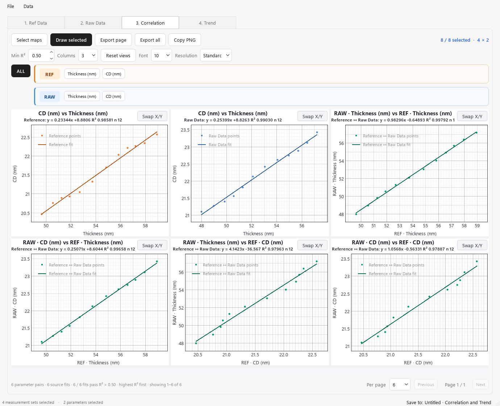
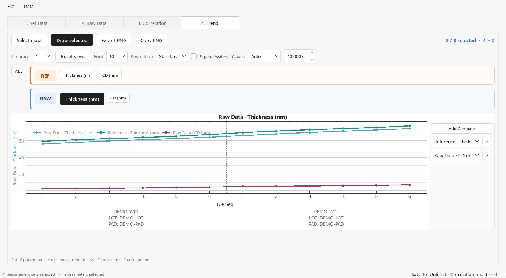

# Correlation and Trend

本工具用于查看数值参数之间的线性相关性，以及参数随 Die / 晶圆序列的变化。窗口分为 **1. Ref Data → 2. Raw Data → 3. Correlation → 4. Trend**。两张数据表分别保留自己的列名、测量组和参数勾选。

## 1. 选择数据入口

| 入口 | 初始数据及使用方式 |
| --- | --- |
| 主界面 **Correlation and Trend** | 独立分析。可只导入 Raw Data 做同表参数相关性 / 趋势，也可同时导入 Ref Data 做跨表比较。 |
| **Type1 Match Workbook** 的 Correlation and Trend 子窗口 | 新建子窗口默认跟随工作簿的 Raw Data；Ref Data 初始为空，需自行导入或粘贴。**Data → Copy Raw Data from WKB** 控制 Raw 的跟随，手工 Ref 不会因此被替换。 |
| **Type2 Match Workbook** 的 Correlation and Trend 子窗口 | **Data → Copy ID-matched data from WKB** 默认跟随工作簿的 Raw 和按所选 ID 字段匹配后的 Reference。跨表相关性仅使用匹配成功的记录；Trend 可以保留 Raw 序列及未匹配位置的 Reference 空缺。 |

从工作簿打开时，先确认当前 **Preview / Final** 阶段。子窗口可以跟随工作簿更新，已有独立输入时，恢复跟随或切换数据范围可能要求确认替换。取消 Copy 选项会清除相应输入并转为手工数据，请先保存需要保留的内容。

## 2. 导入与核对两张表

1. 切换到相应数据页，点击 **Open file** 读取 CSV / XLSX，或在 Excel 中连同表头复制后点击 **Paste table**。XLSX 默认读取第一个工作表；其他 PAD / 工作表请复制粘贴。厂商原始 REF 可先用 [Summarize REF](summarize_ref.md) 整理。
2. 第一行是列名，其后每行是一条测量记录。列名应唯一；出现重名提示时先修改表头。**Paste table** 用于整表导入；在表格内按 **Ctrl+V** 则从当前单元格粘贴。
3. 建议保留 **Wafer ID、Lot ID、PAD Name、Die Seq** 和所需测量参数。Trend 需要可识别的 Wafer ID；普通相关性不要求 FIELD X / FIELD Y 坐标。
4. 在两页各自的 **Wafers** 中勾选测量组，用 **Select grouping columns** 确认身份字段。例如同一晶圆有多个 Lot / PAD 时，用完整组合区分，避免混成一组。
5. 在各自的 **Parameters** 中勾选数值参数，可用搜索框查找列。**Numeric** 只控制列表是否显示非数值列；Wafer、坐标、Die Seq、TestFlag 等元数据不作为普通建模参数。

**跨表配对是本页最重要的检查项：** 手工导入两张表时，跨表 Correlation 使用同一行位置的 REF 与 RAW，不会根据 Wafer ID、Die Seq 或坐标自动连接。两表必须行数相同，且第 1 条、第 2 条……记录分别对应同一测量点。相同的行数并不能证明对应关系正确；不要只对其中一张源表重新排序。需要按 ID 连接时，先在 Type2 工作簿完成匹配，再打开其子窗口。

对于没有任何身份字段、且行数恰好与 Raw 相同的“纯参数”Ref 导入，程序可以从 Raw 补入身份字段；这只是赋予行身份，仍需事先确认行顺序正确。Ref 自带的身份字段会保留。

## 3. 控制参与范围

先确定“使用哪些记录”，再确定“绘制哪些测量组 / 参数”：

| 控件 | 作用 |
| --- | --- |
| **Data → Match Workbook selection** | 工作簿子窗口默认采用父工作簿已选数据。 |
| **Data → Full data (before selection)** | 从父工作簿重新复制 selection 前的完整数据。只在有所属工作簿时可用。 |
| **Data → Data selection…** | 对本窗口记录追加参与勾选，点击 **Apply** 生效。搜索 / 条件筛选本身只改变可见记录，**Use** 勾选才决定参与分析。跟随父 selection 时提交本地选择会转为 Full data，本地修改不改变父工作簿。 |
| 数据页 **Wafers / Parameters** | 决定本次可供选择的测量组及参数。 |
| 绘图页 **Select maps** | 在“测量组 × 参数”矩阵内选择本页实际绘制的格子。Correlation 与 Trend 各自保留选择。 |
| 绘图页参数按钮 | 在已经计算 / 绘制的结果中筛选展示，不改变源表或参与勾选。 |

Data selection 窗口的 **Selection Script** 可复制 / 粘贴选择方案，**Copy WKB Selection** 可一次性复制父工作簿的方案；复制后可在本窗口独立修改。跨窗口选择按记录身份应用，不应把它当作 REF / RAW 的配对工具。

## 4. Correlation：线性相关性

### 操作步骤

1. 打开 **3. Correlation**，点击 **Select maps**。
2. 在矩阵中选择测量组与参数。可拖动选择，**Ctrl** 增减选择、**Shift** 扩展选择，**All / None** 全选 / 清空。同表相关性至少要有两个参数，并在同一测量组上同时选中这两个参数；跨表可各选一个参数，但要有共同选中的对应行。
3. 点击 **Draw selected**。程序计算 `Y = slope × X + intercept` 的带截距普通最小二乘拟合，并在图内显示拟合信息。
4. 调整 **Min R²** 过滤结果。默认值为 **0.50**（已有设置可能不同），仅显示 **R² 严格大于阈值** 的拟合；等于阈值也会隐藏。设为 1.00 时不会显示通常的 R² ≤ 1 结果。
5. 查看图标题与轴名，区分 REF 内、RAW 内及 REF ↔ RAW 的参数对。双表结果按 **Reference 内部 → Raw Data 内部 → 跨表** 排列，每类内部按 R² 从高到低显示。
6. 使用 **Per page（6 / 12 / 24）**、**Previous / Next** 翻页，使用 **Columns（2 / 3 / 4）** 调整每行图数。

*图：实际程序渲染的演示数据，展示两张表的参数来源和跨表拟合；数值不代表真实工艺结论。*

### 参数按钮与 X/Y 方向

- **ALL** 显示所有满足条件的已绘制拟合。
- 单击参数只看包含该参数的图；**Ctrl+单击** 多选时显示包含任意所选参数的图。
- **Ctrl+Alt+单击** 选择两个或更多参数时，只显示所选集合内部的两两参数对。例如选 A、B、C，仅保留 A–B、A–C、B–C。REF / RAW 的同名参数按来源分别选择，不会混为同一列。
- 每张图的 **Swap X/Y** 交换轴，并以同一批有效观测重新拟合。含噪声时，反向回归的斜率通常不等于原斜率的倒数；导出的方向与当前图一致。

### 结果如何解读

拟合会逐对排除空白、非数值及无穷值；每对至少需要 **3 个有效配对点**，且 X、Y 都不能是常量。不同参数对可能使用不同数量的有效点，状态栏会提示跳过的无效参数对。

R² 描述这些观测点对线性模型的符合程度，不能单独证明两个量测结果一致。核对校准 / 一致性时，还应结合 slope 是否接近目标值、intercept 的量级、散点与异常点，以及下方 Trend 的序列变化判断。斜率与截距按当前单位计算，本工具不会自动换算不同单位。

## 5. Trend：查看序列与叠加比较

### 基础绘图

1. 打开 **4. Trend → Select maps**，选择所需测量组和参数，点击 **Draw selected**。一个数值参数即可绘制。
2. 默认按来源分别生成参数图，Reference 为橙色、Raw Data 为蓝色；同一参数的多个测量组连续排列，并在横轴下标出晶圆 / 身份信息。横轴是串接后的测量序列，不是实际时间，也不是晶圆上的物理距离。
3. 独立分析通常在每个测量组内按数值 **Die Seq** 稳定排序。若没有 Die Seq 列，则用 **Row Number**，保留表格行号含义（第 1 行是表头，第 1 条数据为第 2 行）；已有 Die Seq 列中的空白 / 非数值不会自动改用行号。
4. 工作簿子窗口沿用已应用的分组与 Trend order；**Original row order**、**Original Wafer order** 或分组排序可能覆盖上述组内 Die 排序。Type2 的 Mark2 分类也由父工作簿设置决定。
5. 晶圆标签拥挤时勾选 **Expand Wafers**，使用底部水平滚动条浏览。**Columns（1 / 2）** 调整图的排列。

### Add Compare 与双轴

每张图旁的 **Add Compare** 可加入其他已选的“来源 + 参数”，可多次添加。用下拉框更换比较曲线，或在下拉框上滚动切换；点击 **×** 移除该项。没有候选项时，先回到数据页及 Select maps 补选需要的参数和测量组。

*图：演示数据中的参数叠图。右侧比较下拉框注明曲线来自 Reference 还是 Raw Data。*

| Y axes | 叠图规则 |
| --- | --- |
| **Auto** | 同单位且量级相近时共用 Y 轴；单位不同，或两个序列的“绝对值中位数”之比超过阈值时，使用第二 Y 轴。初始阈值为 **10×**，可修改。 |
| **Always 2** | 比较曲线使用第二 Y 轴。 |
| **Always 1** | 强制共用 Y 轴；单位不同时会标注混合单位。请结合曲线单位与刻度判断。 |

独立窗口在 Trend 顶部设置 **Y axes**；由工作簿管理的子窗口使用父窗口 **Analysis → Trend Y axes**，页内控件可能隐藏。

单位优先取列名末尾的 `(单位)` 或 `[单位]`。未标单位的 OCD 参数按名称推定：含 `ratio` 视为无量纲，含 `SWA` 视为角度，其余按 nm。若数据不符合这些约定，请在列名中明确单位；尤其注意 Summarize REF 的 KLA / PMISH 结果会移除圆括号单位。**轴的分配不会进行数值换算或归一化**，使用双轴时应分别读左右刻度。

Trend 保留测量值的真实缺失，缺失处断线，不插值。相邻有效点跨晶圆 / 分组边界可能连续连接，因此应结合边界和标签识别换片；跨表叠图前同样要确认两表身份、位点与选择范围一致。

## 6. 浏览、导出与保存

- **Ctrl+滚轮** 缩放图，左键拖框放大、右键拖动平移；普通滚轮滚动页面。**Reset views** 恢复初始视野。
- **Font** 调整图中文字，**Resolution** 控制 PNG 输出质量，不改变屏幕数据。输出过大时程序会限制像素量，状态栏会说明实际分辨率。
- Correlation 的 **Export page / Copy PNG** 输出当前页；**Export all** 输出当前参数筛选与 Min R² 下的所有分页，多页文件追加 `_01`、`_02` 等编号。
- Trend 的 **Export PNG / Copy PNG** 输出当前参数展示范围的完整图组。**Copy PNG** 捕获屏幕绘图区，**Export** 根据数据重新排版出图；不要假定屏幕上的局部缩放范围会原样用于 Export。两者保留当前参数选择、轴方向及比较设置，使用前请检查输出图片。
- **Export CSV** 只导出相应数据页的表格，不包含绘图设置。独立窗口用 **File → Save / Save As…** 保存为 **`.wct`**，保留两张表、选择和图形设置；工作簿管理的子窗口用 **Ctrl+S** 保存所属 **`.mwkb`**。PNG、CSV 或 REF 汇总 Excel 不能代替可继续编辑的工作区文件。
- 首次绘图后，数据编辑、参与选择及工作簿更新会刷新已有绘图。使用结果前等待 **Updating / Drawing** 完成；新增测量组或参数后到 Select maps 核对是否已选。

## 7. 常见问题

| 现象 | 检查与处理 |
| --- | --- |
| Correlation 没有图 | 确认参数 / 矩阵选择有交集、至少 3 个有效配对点、两列非常量；降低 Min R²，再点 ALL 排除展示筛选影响。 |
| 提示跨表需要 row-aligned source tables | 两张源表行数不相等。先整理成逐行对应的数据，或在 Type2 中按 ID 匹配；仅想看一张表时，取消另一来源的测量组 / 参数勾选。 |
| 同名参数出现两套 | REF 与 RAW 的同名列是不同来源的序列，按按钮分区及图标题区分。 |
| Trend 提示需要 Wafer ID | 补上可识别的晶圆标识列，再检查 Wafers 的身份字段与勾选。 |
| Trend 缺少某些点 | 检查 Use、Wafers、Parameters 和矩阵选择，再检查 Die Seq 与参数是否有效；已有 Die 列但值为空时不会用行号补齐。Type2 的 Reference 还可能因 ID 未匹配而为空。 |
| Add Compare 不可用或比较曲线缺失 | 确认另一来源 / 参数已选且具有有效数据；检查测量组身份和位点是否对应。 |
| Ref 被意外替换 / Raw 随父窗口变化 | 检查 Type1 / Type2 及 Data 菜单中的 Copy 选项。Type1 的 Ref 是手工输入；Type2 跟随时两表受父工作簿管理。 |

[返回欢迎页](welcome.md)
