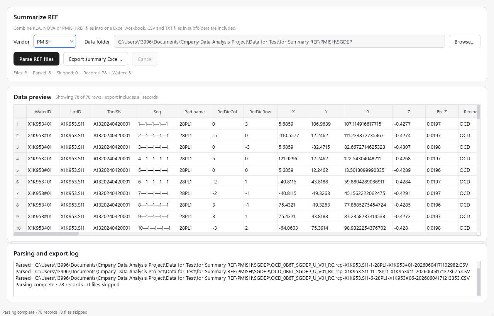

# Summarize REF

将 **KLA、NOVA 或 PMISH** 的 REF 原始文件批量整理成一个 Excel 工作簿，供后续核对或导入分析。这里的 Summary 是逐条记录的合并表，不是均值、标准差等统计汇总。

## 1. 准备数据

- 在软件主界面打开 **Summarize REF**。
- 每次选择一个厂商，以及只包含本次待整理数据的文件夹。程序会递归扫描其中所有子文件夹的 **CSV / TXT** 文件，扩展名大小写均可。
- 解析器按 UTF-8 文本读取，数据段使用逗号分隔；TXT 扩展名不代表支持任意文本格式。遇到乱码或编码错误时，先检查原文件编码，保留原件并另存 UTF-8 副本后再试。
- 建议按“厂商 → 工艺 / 项目 → 本次批次”整理目录。不要直接选择同时包含 KLA、NOVA、PMISH 或其他无关 CSV/TXT 的总目录；Vendor 不会逐文件自动识别。
- 可以把多个晶圆、多个 PAD 的文件放入同一批次。文件按路径排序后合并，文件内记录沿用解析顺序；程序不按时间、Wafer 或 Die 重新排序，也不自动去除重复测量记录。

## 2. 解析、核对与导出

1. 在 **Vendor** 中选择 **KLA / NOVA / PMISH**。
2. 点击 **Browse…**，选择数据文件夹，检查 **Data folder** 的路径。
3. 点击 **Parse REF files**。解析在后台进行，进度条及 **Parsing and export log** 显示文件处理情况。需要中止时点击 **Cancel**，本次未完成结果会被丢弃。
4. 解析完成后检查统计行：**Files** 为扫描到的文件数，**Parsed** 为成功文件数，**Skipped** 为失败文件数，**Records** 为合并后的记录数，**Wafers** 为非空 Wafer ID 的去重数量。相同 Wafer ID 在不同 Lot / PAD 下仍只计一次，不能用此数量代替完整的测量组数量。
5. 在 **Data preview** 核对 Wafer、Lot、PAD、位点编号及参数列。预览只显示前 **100** 行，且不能直接编辑；**导出包含全部已解析记录**。
6. 如有 **Skipped**，在日志中找到对应路径和原因。个别文件失败不会中止整批，仍可导出其他成功文件；确认是否允许缺少这些文件后再使用结果。
7. 点击 **Export summary Excel…**，选择保存位置。默认文件名为 `KLA_REF_Summary.xlsx`、`NOVA_REF_Summary.xlsx` 或 `PMISH_REF_Summary.xlsx`。等待日志显示导出完成，再打开 Excel 核对工作表和记录数。

*图：使用项目测试目录中的 PMISH SGDEP 文件生成的实际界面。路径和记录仅用于说明操作位置。*

更换 Vendor、重新选择文件夹或重新开始解析会清除当前预览和可导出结果。导出后关闭窗口即可；此工具不创建 `.mwkb`，原始 REF 文件也不会被改写。

## 3. 三种厂商格式与工作表规则

| Vendor | 输入格式与解析规则 | Excel 输出 |
| --- | --- | --- |
| **KLA** | 识别以 `Site #,` 开头的数据段，读取附近的 `WAFER ID`、`LOT ID`、`RECIPE`、`TEST LABEL` 等信息。一个文件可含多个 PAD 数据段。 | 按 PAD 分工作表；加入 `WaferID`、`LotID`、`Recipe`、`PadName`。 |
| **NOVA** | 直接读取带表头、逗号分隔的表格；TXT 也必须符合这一结构。删除“首列内容等于首列表头”的重复表头行。 | 全部记录合并到 **Summary** 工作表，沿用输入列。 |
| **PMISH** | 从文件前六行读取 `WaferID`、`LotID`、`ToolSN`；识别以 `Seq,` 开头的数据段，在 MAX / MIN / AVERAGE 等汇总行前结束。 | 加入 `WaferID`、`LotID`、`ToolSN`；存在 `Pad name` 或 `PadName` 列时按 PAD 分表，否则写入 **Summary**。按 PAD 分表时移除该 PAD 下全空的列。 |

KLA 中，只有当原 Wafer ID 为 `nowaferid`（不区分大小写）时，程序才用 `LotID#Slot` 补出 ID；一位数字 Slot 会补成两位，例如 `LOT_A#03`。导出后应确认补出的 ID 与实际晶圆一致。

KLA / PMISH 会移除列名中圆括号及其中内容，例如 `Thickness (nm)` 变为 `Thickness`，**数值不会随之转换单位**。因此请保留原始文件的单位依据；合并前应确认不同文件的同名参数采用相同单位。去掉括号后如果出现重名列，该文件会被跳过并记入日志。

## 4. 结果检查与后续使用

- 数据按文本读取，测量值中的尾零、长 ID 和前导零会以文本方式写入 Excel；空值保持为空。后续需要计算时由分析工具转换数值，不必先手工四舍五入。
- **Parsed 按文件统计，不代表逐行完整性校验通过。** 例如 KLA 会跳过无法按表格结构读取的异常行；正式使用前，仍应将记录数及关键位点与原始文件核对。
- 不同文件的列可以不同，合并表会保留列的并集，缺失位置为空。重复文件或重叠批次会重复贡献记录，请在输入目录中先排除它们。
- Excel 首行为蓝色表头，并冻结首行。PAD 名中的 Excel 非法字符会替换，表名最多 31 字符；发生重名时会追加序号，因此以表内 PAD 字段为准。
- 可以将结果导入 Match Workbook 或 [Correlation and Trend](correlation_trend.md)。分析窗口通过 **Open file** 打开 Excel 时默认读取第一个工作表；有多个 PAD 时，请在 Excel 中选择所需工作表，连同表头复制，再用目标数据页的 **Paste table** 导入。
- 汇总不会自动完成 REF 与 Raw Data 的位点匹配。后续跨表分析前，仍需核对 Wafer / Lot / PAD / Die 的对应关系，或使用 Type2 工作簿的 ID 匹配。

## 5. 常见问题

| 现象 | 检查与处理 |
| --- | --- |
| **Parse REF files** 不可点击 | 先用 Browse… 选择已有文件夹；任务运行期间也不能重复开始。 |
| 提示没有 CSV / TXT | 确认目录和文件扩展名；此入口不读取 XLSX、SME 或 WKB。 |
| 全部文件被跳过 | 先检查 Vendor，再查看日志中的首个错误。KLA 需要 `Site #,`，PMISH 需要 `Seq,`；NOVA 需要规整的逗号分隔表格。仅修改扩展名不会转换格式。 |
| Parsed 大于 0 但 Skipped 也大于 0 | 结果只包含成功文件。根据日志修正文件或拆分目录后重新解析，核对记录数再使用。 |
| Wafers 为 0 或少于预期 | 检查 `WaferID` / `Wafer_ID` / `Wafer ID` 是否为空或重复；这个计数不按 Lot、PAD 拆分。 |
| 只看到 100 行 | 这是预览上限，导出会包含全部记录。 |
| 导出失败 | 关闭 Excel 中正在占用的同名文件，确认保存目录可写后重试。导出失败或取消时不会用未完成的文件替换原目标。 |

[返回欢迎页](welcome.md)
